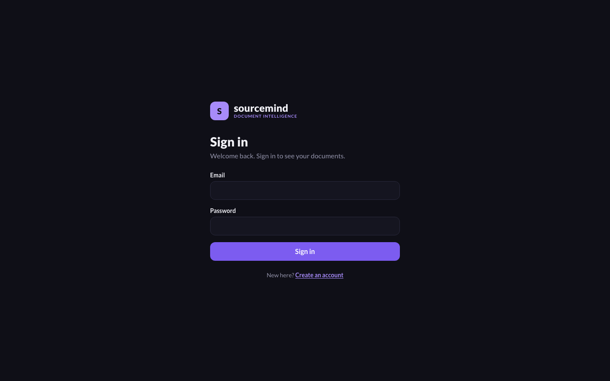

# SourceMind

Evidence-first AI document research assistant, built incrementally as a learning and portfolio project.

## Status

| Milestone | State |
|---|---|
| M1 Backend foundation (health endpoint, tests, config) | Implemented |
| M2 Ingestion and chunking (upload, PDF/TXT/MD extraction, page-aware chunks, limits) | Implemented |
| M3 TF-IDF retrieval (sources-only queries, delete) | Implemented |
| M4 Optional grounded answers (citation validation, fallbacks) | Implemented; verified with a mocked model only, not yet run against a real provider |
| M5 Frontend: 5a shell, upload, document library, evaluation empty state | Implemented (5a upload and library, 5b ask and evidence cards, 5c responsive layout and accessibility polish) |
| M6 Auth, persistence, vectors | 6a done (schema + Row Level Security). 6b done (sign-in, per-user storage). 6c done and verified (34 real-project tests plus a real-browser run): original files in a private bucket, 60-second signed links, **Open page** on citations, resumable deletion; apply the storage migration first (`docs/m6c-apply.md`). 6d implemented offline (local embeddings, `pgvector` search that runs as the caller, a Keyword / Meaning control); **apply migration 3 before uploads work** (`docs/m6d-apply.md`). See `docs/m6-plan.md` |
| M7 Evaluation and deployment | 7a built the corpus, 45 labeled questions (one author) and a reproducible harness. 7b done: held-out test split scored once (`data/evaluation/results/REPORT.md`), failure analysis, and an Evaluation page in the app. Keyword vs meaning Recall@3 on 15 answerable questions: 0.60 vs 0.87, but the 95% intervals overlap, so **no difference is demonstrated**. Product defaults are unchanged. 7c hardening done offline and against the real project: API security headers, docs off outside local, per-user rate limits and a daily generation cap, a nonce-based web Content-Security-Policy, a sweep for abandoned uploads, a data-handling statement, and Claude as the answer provider. Still to do: email confirmation and SMTP are on in the dashboard (not in code); 7d (deployment) is planned and nothing is deployed |

Every API route except `/api/v1/health` requires a signed-in user, and documents live in Postgres per user. There is no anonymous or local no-login mode. The app runs locally; it is **not deployed anywhere yet**. See [Limitations](#limitations) and [docs/data-handling.md](docs/data-handling.md) (what is stored, what leaves your machine, retention) before uploading anything.

## Screenshots

Taken from the running app with a synthetic sample document (`data/sample/`). Retrieval-only mode, no model key. The answer and drawer shots predate sign-in; the layout is unchanged apart from a sign-out control.

| Sign in | Desktop, answer with evidence | Phone, sources drawer |
|---|---|---|
|  |  |  |

## Run the API (local)

```bash
cd apps/api
python3 -m venv .venv
source .venv/bin/activate
pip install -r requirements.txt
cp .env.example .env            # optional
uvicorn app.main:app --reload --host 127.0.0.1 --port 8000
curl http://127.0.0.1:8000/api/v1/health
```

## Test

```bash
cd apps/api && source .venv/bin/activate
python -m pytest -q                  # offline, fast
python -m pytest -m integration      # the real Supabase project; needs two confirmed test accounts (docs/m7c-test-accounts.md)
```

## API

| Method | Path | Behavior |
|---|---|---|
| GET | /api/v1/health | readiness |
| POST | /api/v1/documents | multipart upload (`file`); returns id, page/chunk counts, `status: ready` |
| GET | /api/v1/documents | list documents |
| GET | /api/v1/documents/{id} | document metadata |
| DELETE | /api/v1/documents/{id} | remove document and its chunks (204) |
| POST | /api/v1/queries | TF-IDF top-k evidence with page numbers; `insufficient_evidence: true` when nothing scores above the gate |

Rejections: unsupported type or bad signature/encoding (400), encrypted or corrupt PDF (400), empty or text-less/scanned PDF (422), too large or too many pages (413), document limit reached (409).
Limits are configurable via `MAX_UPLOAD_BYTES`, `MAX_PDF_PAGES`, `MAX_DOCUMENTS`, `CHUNK_SIZE`, `CHUNK_OVERLAP` (see `apps/api/.env.example`).

Query example:

```bash
curl -X POST http://127.0.0.1:8000/api/v1/queries -H 'Content-Type: application/json' \
  -d '{"question": "What are the limitations?", "top_k": 4}'
```
Optional: `document_ids` to restrict the search. `mode` is `sources_only` (default) or `generated`. Tuning knob: `MIN_RELEVANCE_SCORE` (untuned heuristic).

## Optional answer generation (Claude)

Off by default. Create an API key in the [Anthropic Console](https://console.anthropic.com), then set both `ANTHROPIC_API_KEY` and `ANTHROPIC_MODEL` (for example `claude-haiku-5-5`, `claude-sonnet-5-5` or `claude-opus-5-5`) in `apps/api/.env`, restart the API, and send `"mode": "generated"`. `GET /api/v1/health` reports `generation_available` (a boolean, never the key). The model is your choice and has no default, because price and quality differ a lot between them.

- The model sees only the retrieved excerpts, numbered `[1]`, `[2]`, ... and is told to treat them as untrusted data.
- Code, not the prompt, enforces grounding: citations the model invents are stripped, an answer with no valid citation is withheld, and a model failure, a refusal or a missing key falls back to `sources_only` with a `notice`.
- With generation enabled, retrieved excerpts and the question are sent to Anthropic. Don't enable it for confidential documents, and check Anthropic's current data-retention terms for your account before relying on any retention assumption.
- Cost controls: `MAX_CONTEXT_CHARS` (evidence sent) and `MAX_ANSWER_TOKENS` (output cap, default 2000; it includes the model's thinking, which counts toward the limit). `ANTHROPIC_EFFORT` (default `low`) sets how hard the model thinks; set it empty only for older models that reject it. Per-user limits apply (defaults: 30 questions per minute, 10 uploads per hour, 120 other requests per minute, 20 generated answers per rolling 24 hours; see `.env.example`). Past the daily allowance you still get the retrieved evidence, without a model call. **The counters live in the server's memory**: they reset on restart and would multiply across several server instances, so a multi-instance deployment needs a shared store first.
- Also set a monthly spend limit in the Anthropic Console. The per-user caps here do not bound your total bill.

## Run the web app (local)

Start the API first (above), then in a second terminal:

```bash
cd apps/web
cp .env.example .env.local      # then fill in your Supabase URL and PUBLISHABLE key (never the service-role key)
npm install
npm run dev          # http://localhost:3000
```

You sign in with a Supabase account (the sign-in page can also create one). The API needs `SUPABASE_URL` and `SUPABASE_ANON_KEY` in `apps/api/.env` and refuses to start without them.

The API allows browser calls only from `FRONTEND_ORIGIN` (default `http://localhost:3000`), so open the app at `localhost`, not `127.0.0.1`. The API address defaults to `http://localhost:8000`; override it with `NEXT_PUBLIC_API_URL` (a URL only, never a secret). Checks: `npm test`, `npm run lint`, `npm run build`.

## Demo data

`data/sample/adaptive-practice-brief.pdf` is a 3-page synthetic document (invented content, no real people or data) for trying the app. Regenerate it with `data/sample/make_sample_pdf.py`.

## Accessibility checks

The UI was checked in a headless browser at desktop and phone widths with axe-core (WCAG 2.0/2.1/2.2 A and AA rules): 0 violations on the 9 views tested, no horizontal overflow, skip link first in tab order, Escape closes the sources drawer. This is an automated scan plus manual review of screenshots, not a full audit with assistive technology.

## Limitations

What this project does not do, or has not proven. Nothing here is hidden in the code; it is listed so the claims above stay honest.

**Search and evaluation**
- The evaluation is small and single-author: 45 questions written by the project assistant over five US government documents (19 held out for the final test). Intervals overlap, so no search method is demonstrated to be better. It measures retrieval only, not whether generated answers are correct or well cited.
- Keyword search is the default and fails on paraphrases (Recall@3 0.43 on 7 paraphrase test questions). Both "not enough evidence" thresholds are provisional. The values tuned on the development split were not adopted: the tuned keyword threshold refused 67% of answerable test questions, and abstention rests on only 4 unanswerable questions, so the defaults were left alone.
- Meaning search uses an English-oriented 384-dimension model and an exact scan per user (no approximate index), which is fine for a dozen documents and not designed for large libraries.
- Scanned (image-only) PDFs are rejected; there is no OCR. Supported: PDF, TXT, MD, up to 12 MB, 150 pages and 12 documents per user.

**Answer generation**
- Off unless you add an Anthropic key and choose a model. It works end to end (checked by hand), but answer quality and citation accuracy are unmeasured, and refusal and provider-error paths are tested only with fakes.
- Cost is bounded per user (rate limits and a daily cap) but not in total. Set a spend limit in the Anthropic Console.

**Security and operations**
- Rate-limit counters are in server memory: they reset on restart and would multiply across several instances.
- No self-service account deletion or data export. Deleting a user with stored files has not been tested (see docs/data-handling.md).
- An upload that genuinely runs longer than the 15-minute cleanup window could be removed while still running.
- The web Content-Security-Policy was verified in a real browser on the sign-in page; the signed-in pages were not covered by an automated browser run.
- Accessibility: the original 9 views were scanned with axe-core and reviewed manually; the Evaluation page has component tests but has not had an axe-core scan, and none of this replaces a test with assistive technology.
- Not deployed: no hosting, uptime, backups policy, monitoring or incident process exists.
