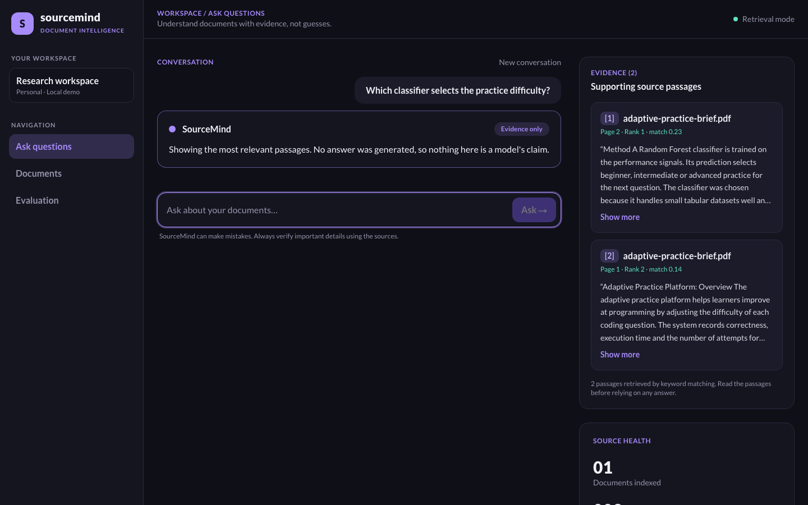
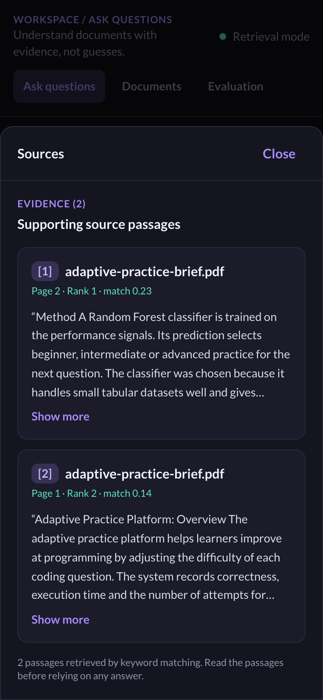

# SourceMind

Evidence-first AI document research assistant, built incrementally as a learning and portfolio project.

## Status

| Milestone | State |
|---|---|
| M1 Backend foundation (health endpoint, tests, config) | Implemented |
| M2 Ingestion and chunking (upload, PDF/TXT/MD extraction, page-aware chunks, limits) | Implemented |
| M3 TF-IDF retrieval (sources-only queries, delete) | Implemented |
| M4 Optional grounded answers (citation validation, fallbacks) | Implemented; verified with a mocked model only, not yet run against a real provider |
| M5 Frontend: 5a shell, upload, document library, evaluation empty state | Implemented (5a upload and library, 5b ask and evidence cards, 5c responsive layout and accessibility polish) |
| M6 Auth, persistence, vectors | Planned |
| M7 Evaluation and deployment | Planned |

Nothing beyond M5 exists yet (no accounts, persistence, vector search or evaluation results). There is no UI or measured evaluation results. Retrieval is a lexical baseline with known failure modes (see `docs/experiments.md`). Documents live in process memory only and are lost on restart. There is no authentication, so run it locally and do not upload confidential files.

## Screenshots

Taken from the running app with a synthetic sample document (`data/sample/`). Retrieval-only mode, no model key.

| Desktop, answer with evidence | Phone, sources drawer |
|---|---|
|  |  |

## Run the API (local)

```bash
cd apps/api
python3 -m venv .venv
source .venv/bin/activate
pip install -r requirements.txt
cp .env.example .env            # optional
uvicorn app.main:app --reload --host 127.0.0.1 --port 8000
curl http://127.0.0.1:8000/api/v1/health
```

## Test

```bash
cd apps/api && source .venv/bin/activate
python -m pytest -q
```

## API

| Method | Path | Behavior |
|---|---|---|
| GET | /api/v1/health | readiness |
| POST | /api/v1/documents | multipart upload (`file`); returns id, page/chunk counts, `status: ready` |
| GET | /api/v1/documents | list documents |
| GET | /api/v1/documents/{id} | document metadata |
| DELETE | /api/v1/documents/{id} | remove document and its chunks (204) |
| POST | /api/v1/queries | TF-IDF top-k evidence with page numbers; `insufficient_evidence: true` when nothing scores above the gate |

Rejections: unsupported type or bad signature/encoding (400), encrypted or corrupt PDF (400), empty or text-less/scanned PDF (422), too large or too many pages (413), document limit reached (409).
Limits are configurable via `MAX_UPLOAD_BYTES`, `MAX_PDF_PAGES`, `MAX_DOCUMENTS`, `CHUNK_SIZE`, `CHUNK_OVERLAP` (see `apps/api/.env.example`).

Query example:

```bash
curl -X POST http://127.0.0.1:8000/api/v1/queries -H 'Content-Type: application/json' \
  -d '{"question": "What are the limitations?", "top_k": 4}'
```
Optional: `document_ids` to restrict the search. `mode` is `sources_only` (default) or `generated`. Tuning knob: `MIN_RELEVANCE_SCORE` (untuned heuristic).

## Optional answer generation

Off by default. Set both `OPENAI_API_KEY` and `OPENAI_CHAT_MODEL` (a model your account supports) in `apps/api/.env` and send `"mode": "generated"`. `GET /api/v1/health` reports `generation_available` (a boolean, never the key).

- The model sees only the retrieved excerpts, numbered `[1]`, `[2]`, ... and is told to treat them as untrusted data.
- Code, not the prompt, enforces grounding: citations the model invents are stripped, an answer with no valid citation is withheld, and a model failure or missing key falls back to `sources_only` with a `notice`.
- With generation enabled, retrieved excerpts and the question are sent to the model provider. Don't enable it for confidential documents.
- Cost controls: `MAX_CONTEXT_CHARS` and `MAX_ANSWER_TOKENS`. No per-user or daily limits yet (needed before any public deployment).

## Run the web app (local)

Start the API first (above), then in a second terminal:

```bash
cd apps/web
npm install
npm run dev          # http://localhost:3000
```

The API allows browser calls only from `FRONTEND_ORIGIN` (default `http://localhost:3000`), so open the app at `localhost`, not `127.0.0.1`. The API address defaults to `http://localhost:8000`; override it with `NEXT_PUBLIC_API_URL` (a URL only, never a secret). Checks: `npm test`, `npm run lint`, `npm run build`.

## Demo data

`data/sample/adaptive-practice-brief.pdf` is a 3-page synthetic document (invented content, no real people or data) for trying the app. Regenerate it with `data/sample/make_sample_pdf.py`.

## Accessibility checks

The UI was checked in a headless browser at desktop and phone widths with axe-core (WCAG 2.0/2.1/2.2 A and AA rules): 0 violations on the 9 views tested, no horizontal overflow, skip link first in tab order, Escape closes the sources drawer. This is an automated scan plus manual review of screenshots, not a full audit with assistive technology.
